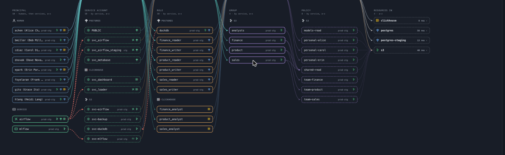

# Grantline

[English](../README.md) · [한국어](README.ko.md) · [日本語](README.ja.md) · [简体中文](README.zh-CN.md)

**복잡한 권한을 풀고, 부여 경로를 따라가세요.**

**PostgreSQL, ClickHouse, S3 호환 스토리지**의 권한을 한곳에서 확인하고 관리하는
오픈소스 대시보드입니다. SeaweedFS도 지원합니다. 역할 기반 접근 제어(RBAC)를
시각화하고, 역할·그룹·IAM 정책을 따라 접근 경로를 추적하며, 실제 권한과 선언의
차이를 검토할 수 있습니다. 권한 집행은 각 서비스가 담당합니다.



## 로컬에서 실행하기

Rust **1.99.0**이 필요합니다. 서버는 Rust, 화면은 Leptos SSR·WASM입니다.
데모는 별도 서버나 인증 정보 없이 실행할 수 있습니다.

```bash
git clone https://github.com/msk-psp/grantline-public.git
cd grantline-public
rustup target add --toolchain 1.99.0 wasm32-unknown-unknown
cargo +1.99.0 install --locked wasm-bindgen-cli --version 0.2.129
RUSTUP_TOOLCHAIN=1.99.0 scripts/build_rust_ui.sh
cargo +1.99.0 run --locked --manifest-path rust/Cargo.toml -- -c examples/demo/grantline.toml serve
```

**http://127.0.0.1:8424/** 에 접속하세요. 첫 화면은 접근 경로 지도입니다.
**서비스**에서 서비스별 리소스를, **권한 표**에서 권한을 비교하고,
**변경**에서 권한 부여·회수 명령을 미리 확인할 수 있습니다.
계정을 선택하면 해당 계정의 권한과 접근 경로가 표시됩니다.

화면은 **영어·한국어·일본어·중국어 간체**를 지원합니다. 각 페이지 상단에서
언어를 선택하면 쿠키에 저장됩니다. 처음 방문할 때는 브라우저 언어를 사용합니다.
계정명, 리소스 경로, 서비스의 원본 명령어는 그대로 표시됩니다.

## Docker로 실행하기

이 버전의 릴리스 워크플로는 UID 10001로 실행되는 native Rust·WASM 이미지를
빌드합니다. Python·Node 런타임은 없습니다. 기존 태그의 런타임은 유지하며,
머지만으로 새 이미지가 발행되지는 않습니다. 현재 소스의 로컬 빌드는
`docker build -t grantline-native:local .`을 사용하세요.

GitHub Release를 발행하면 GHCR에 `linux/amd64`·`linux/arm64` 이미지를 배포합니다.
안정 릴리스는 `latest`도 갱신하며, 사전 릴리스는 해당 버전 태그만 사용합니다.

```bash
docker run --rm -p 127.0.0.1:8420:8420 ghcr.io/msk-psp/grantline-public:latest
```

**http://127.0.0.1:8420/** 에서 인증 정보 없이 내장 데모를 볼 수 있습니다.
실제 시스템은 외부 설정을 마운트하고 실행 기록을 보존하세요.
[컨테이너 설정](usage.md#containers)을 참고하고, 배포 시 릴리스 태그나 digest를
고정하세요. native 이미지에는 PostgreSQL 지원이 내장되어 있습니다.

## 자주 쓰는 명령

```bash
rust/target/debug/grantline-rs -c examples/demo/grantline.toml plan      # 권한 차이와 원본 명령 확인
rust/target/debug/grantline-rs -c examples/demo/grantline.toml plan --json     # 미리보기만 실행, 변경 없음
rust/target/debug/grantline-rs -c examples/demo/grantline.toml history  # 기록한 관측 결과 비교
```

지원하는 native writer는 서비스별 미리보기와 명시적인 `--write --expect HASH`가 필요합니다.
승인과 PR 생성만으로 IAM 권한이 적용되지는 않습니다.

## 실제 시스템 연결하기

실제 설정은 `~/.config/grantline/prod.toml`처럼 저장소 밖에 보관하세요.
설정에는 인증 정보가 담긴 환경 변수의 이름을 지정합니다. 관측용 인증 정보와
쓰기용 인증 정보는 분리합니다. native PostgreSQL은 Python 드라이버가 필요하지 않습니다.

아래 상세 문서는 영어로 제공됩니다.

- [Native 운영·이전·롤백](rust-operations.md): OIDC, Slack·GitHub와 비공개 상태.
- [설정과 운영](usage.md): 어댑터, 인증 정보, 브리지, 권한 선언, 접근 확인, 관측 기록과 승인.
- [보안](../SECURITY.md): 콘솔 공유와 쓰기 활성화. native 공유 배포는 OIDC 또는 신뢰할 수 있는 인증 프록시를 설정해야 합니다.
- [기여하기](../CONTRIBUTING.md): 개발 환경과 검사 방법.
- [제품 범위](prd/003-scope.md): 요구사항과 구현 현황.

읽지 못한 범위는 **알 수 없음**이며, “접근 권한 없음”으로 처리하지 않습니다.
모든 쓰기는 원본 명령을 먼저 보여주고, 실행 시도와 결과를 감사 기록에 남깁니다.
선언에 따른 권한 회수는 관리 대상으로 지정한 계정과 선언이 다루는 시스템으로 제한됩니다.

서비스와 기본 컨테이너는 Rust/Leptos입니다. 최소 Python 참조 코드는
[tests/reference](../tests/reference/README.md)에 비교 검증용으로만 남기며,
서비스 진입점과 컨테이너 이미지에는 포함하지 않습니다.

## 라이선스

[Apache-2.0](../LICENSE).
